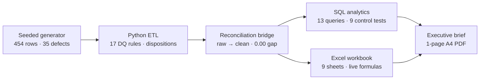

# Expense Variance & Control Review

**Budget-vs-actual analytics and internal-control testing on a synthetic retail ledger (H1 2026).**


> [!WARNING]
> **Educational / synthetic data.** Every transaction in this repository is
> generated. There is no real employer, client, bank, payroll or personal data,
> and vendor names are illustrative. This is **not** a statutory audit, assurance
> engagement, audit opinion or financial advice. No conclusion on fraud or error
> is drawn anywhere. The project demonstrates an analytical workflow on synthetic
> data; it does not provide assurance over any real entity.

**What this is.** A reproducible analytics workbench that takes a deliberately
messy 454-line expense ledger through data-quality triage, a cent-balanced
reconciliation, variance analysis, SQL control tests, a formula-driven Excel
workbook and a one-page executive brief.

**Why it matters.** It shows the whole analyst workflow — not just a chart, but
the evidence, caveats and follow-up questions behind the numbers.

---

## At a glance

| Measure | Result |
|---|---:|
| Raw transactions → clean ledger | **454 → 442 rows** |
| Budget | **€2,027,057.54** |
| Actual | **€2,086,437.42** |
| Net variance | **+€59,379.88 (+2.93%) adverse** |
| Data-quality checks | **17** (35 planted defects) |
| Quarantined / out of period | **10 rows (€51,542.41)** / **2 rows (€23,288.60)** |
| Included but flagged | **18 rows** |
| Control risks mapped | **9** |
| Follow-up items | **3** |

---

## Business context & objectives

A fictional five-department retailer closes H1 2026 with 454 expense lines across
eight categories and a €2.09M budget. The board pack shows spend running **2.9%
above budget**, but finance cannot explain the gap — and the ledger itself is
suspect: duplicate postings, blank and malformed dates, inconsistent category
labels, a negative budget and several negative "credits".

The review answers five questions:

1. **Where** did spend exceed budget — by category, month, department and line?
2. **How much** of the gap is real, and how much is a data-quality artefact?
3. **Which items** deserve evidence-based follow-up, and what evidence is needed?
4. **Which controls** should prevent or detect these issues, and which can the
   ledger actually test?
5. **How do you communicate** a variance without overclaiming or blaming people?

**Objectives**

- Reconcile the raw file to a clean ledger with a zero-gap bridge.
- Quantify variance at category, month, month × category, department and line level.
- Apply 17 automated data-quality rules and a five-way disposition framework.
- Map nine control risks to evidence and state what the data can and cannot prove.
- Produce three follow-up items and a one-page management brief.

---

## Architecture & pipeline flow



| Stage | Tool | Output |
|---|---|---|
| 1. Generate | Python (`random`, seeded `20261122`) | 454-row CSV + metadata and defect register |
| 2. Profile | pandas | Read-only data profile |
| 3. ETL & DQ | pandas | Audited rows, clean ledger, exception log, DQ summary, reconciliation, summaries |
| 4. Analyse | PostgreSQL 19 | 2 tables, 5 views, 13 queries, 9 control tests |
| 5. Package | openpyxl | 9-sheet workbook with live formulas |
| 6. Communicate | HTML/CSS → Edge PDF | One-page A4 management summary |

The **reconciliation gate** is deliberate: no number reaches the brief unless
`raw − exclusions = clean` balances to **0.00**. The verified bridge is:

| Step | Rows | Budget (EUR) | Actual (EUR) |
|---|---:|---:|---:|
| Raw file | 454 | 2,094,168.45 | 2,161,268.43 |
| Less: exclusions | 12 | 67,110.91 | 74,831.01 |
| **Clean ledger** | **442** | **2,027,057.54** | **2,086,437.42** |
| **Check** | **0** | **0.00** | **0.00** |

---

## Key analytical findings

### Category variance

| Category | Txns | Budget | Actual | Variance | Var % |
|---|---:|---:|---:|---:|---:|
| Freight & Delivery | 45 | 184,255.56 | 215,084.80 | **+30,829.24** | +16.73% |
| Maintenance & Repairs | 67 | 156,463.29 | 182,238.82 | **+25,775.53** | +16.47% |
| Software & Cloud | 46 | 136,628.40 | 157,817.11 | **+21,188.71** | +15.51% |
| Professional Services | 33 | 150,614.20 | 165,957.96 | +15,343.76 | +10.19% |
| Office & Supplies | 84 | 71,945.14 | 78,967.82 | +7,022.68 | +9.76% |
| Digital Ads & Promo | 14 | 55,088.23 | 52,490.58 | −2,597.65 | −4.72% |
| Utilities & Rent | 67 | 427,608.28 | 415,536.36 | −12,071.92 | −2.82% |
| Payroll & Overtime | 86 | 844,454.44 | 818,343.97 | −26,110.47 | −3.09% |
| **Total** | **442** | **2,027,057.54** | **2,086,437.42** | **+59,379.88** | **+2.93%** |

Positive variance = adverse (actual above budget). Percentages are suppressed
where the budget is zero, below €100 or negative.

### The three follow-up anomalies

| # | Item | Transaction(s) | Variance | Var % | Why it was selected |
|---|---|---|---:|---:|---|
| 1 | Expedited air freight | TXN-2166 | +15,077.37 | +390.07% | Largest single adverse line; June freight +44.6% |
| 2 | Emergency chiller replacement | TXN-2326 | +12,340.36 | +444.72% | Second-largest line; possible capital-vs-revenue issue |
| 3 | Duplicate invoice pairs | TXN-2364/2451, TXN-2348/2452 | 7,289.32 | — | Exact business-key duplicates; payment status unknown |

Each follow-up is written as **observation → possible causes → evidence required →
conclusion pending**. None asserts error, fraud or misconduct. The third item
covers two pairs: €6,394.95 payroll and €894.37 office supplies.

The narrow variance threshold (`|variance| ≥ €1,000` **and** `|variance %| ≥ 10%`)
returns 19 included lines. The broader candidate screen in
`data/processed/follow_up_candidates.csv` (`|variance| ≥ €1,000` **or** unbudgeted
**or** credit note **or** outlier) returns 25. The three items above are then chosen
by judgement; the duplicate pair is a recording exception from the DQ log, not a
variance-screen item.

### What the numbers actually say

- **Three months carry most of the gap.** January, May and June contribute
  €52.6k of the €59.4k overspend — each tied to a different one-off (chiller,
  annual licence, air freight). A single "monthly overspend" story would mislead.
- **Freight is a trend, not just one invoice.** It is adverse in five of six
  months. Excluding TXN-2166 *and its budget*, June freight is still +€6,263
  (+14.3%).
- **Payroll's −€26.1k is not automatically a saving.** It is below budget every
  month, which points to vacancies or timing; it needs a headcount explanation.
- **Utilities' −€12.1k is partly credit notes.** Add back the two utilities
  credits and the category is still favourable, but only −€7,910 (−1.9%).
- **Software's May spike is a timing question.** TXN-2130 (+€9,867) is an annual
  licence billed in one month; the cost may be valid but badly phased.

---

## Data quality & control governance

### 17 automated checks, five dispositions

Every affected row receives a machine-readable flag and one disposition:

| Disposition | Meaning | Rows |
|---|---|---:|
| `INCLUDE` | Passes all checks | 417 |
| `CORRECT_AND_INCLUDE` | Fixable defect, corrected with a logged before/after | 7 |
| `INCLUDE_FLAGGED` | Legitimate but noteworthy; stays in totals, goes to review | 18 |
| `QUARANTINE` | Cannot be validated; excluded and disclosed | 10 |
| `EXCLUDE_OUT_OF_PERIOD` | Valid but outside H1 2026; excluded and disclosed | 2 |

The governing rule: **exclude only what cannot be validated; never exclude a
large variance merely because it is large.** Outliers stay in the ledger and move
to the follow-up list.

**What the 17 checks found**

- 2 exact duplicate pairs (€7,289.32) and 2 near-duplicate pairs (€7,229.70
  exposure, both sides retained and flagged).
- 4 missing dates (€24,677.13), 3 invalid dates (€13,104.76), 1 normalised date.
- 2 out-of-period rows (€23,288.60): 2025-12-28 and 2026-07-03.
- 6 non-canonical category labels corrected; 0 unmapped categories remain.
- 1 negative budget (−€2,500), 4 credit notes (€5,293.69), 3 unbudgeted lines
  (€10,421.61), 2 tiny budgets, 5 outliers, 2 blank descriptions.
- 35 planted defects in total, all detected and disclosed.

### 9-risk control matrix

| # | Risk | What the ledger can show |
|---|---|---|
| 1 | Invoice recorded/paid twice | 2 exact duplicate pairs found; payment duplication untestable without bank data |
| 2 | Purchase without approval | Not testable — no PO or approval field |
| 3 | Incorrect expense coding | 6 labels corrected; 2 blank descriptions cannot be coded |
| 4 | Unbudgeted spend | 3 lines, €10,421.61 — a budget-coverage gap |
| 5 | Capex treated as repairs | TXN-2326 is the candidate; needs asset register and policy |
| 6 | Freight rate leakage | Category and line variance testable; rate card needed for price |
| 7 | Credit notes unmatched | 4 credits, €5,293.69; supplier statements needed |
| 8 | Period cut-off error | 2 out-of-period rows, €23,288.60 |
| 9 | Poor DQ in reporting | 35 defects, 10 quarantined, 18 flagged |

The matrix separates **control design** ("does a rule exist?") from **operating
effectiveness** ("did it run?"). The ledger can test recording and detect
anomalies; it cannot prove that payment or approval controls operated without
logs, POs and bank records. That boundary is stated explicitly rather than
papered over.

Full detail: [`docs/data_quality_report.md`](docs/data_quality_report.md) ·
[`docs/risk_control_matrix.md`](docs/risk_control_matrix.md)

---

## Repository structure

```text
expense-variance-control-review/
├── data/
│   ├── synthetic_retail_expenses.csv            # 454-row canonical ledger (synthetic, seeded)
│   ├── synthetic_retail_expenses.metadata.json  # generation metadata + 35-defect register
│   ├── README.md                                # schema, labels, anomaly register, regeneration
│   └── processed/                               # generated: audited rows, DQ log, reconciliation, summaries
├── scripts/
│   ├── generate_synthetic_data.py               # deterministic generator (seed 20261122)
│   ├── profile_synthetic_data.py                # quick read-only data profile
│   ├── etl_review.py                            # 17 DQ rules, dispositions, variance, reconciliation
│   ├── build_workbook.py                        # 9-sheet Excel workbook with live formulas
│   └── run_sql.py                               # creates the database, runs SQL via psql, saves output
├── sql/
│   ├── README.md                                # run guide + verified PostgreSQL results
│   ├── 01_create_tables.sql                     # staging + fact tables, 5 views, 4 indexes
│   ├── 02_variance_and_dq_queries.sql           # 13 analysis queries (A–M)
│   ├── 03_load_data.sql                         # \copy load + load check
│   ├── 04_control_tests.sql                     # 9 detective tests (T01–T09)
│   └── output/                                  # captured psql evidence from the verified run
├── docs/
│   ├── methodology.md                           # assumptions A01–A14, rules, data dictionary
│   ├── data_quality_report.md                   # 17 checks, reconciliation, detailed findings
│   ├── variance_commentary.md                   # category, month and line commentary
│   ├── follow_up_items.md                       # 3 evidence-based follow-ups + watch list
│   ├── risk_control_matrix.md                   # 9 risks, controls and testability
│   ├── management_summary.md                    # one-page executive brief (Markdown)
│   ├── management_summary.html                  # print-ready A4 source
│   ├── management_summary.pdf                   # generated one-page PDF
│   └── coach_questions.md                       # 3 model answers on judgement and communication
├── deliverables/
│   └── expense_review_workbook.xlsx             # 9 sheets, live variance and SUMIFS formulas
├── power_bi/
│   └── README.md                                # dashboard design spec (report not yet built)
├── tests/
│   ├── test_pipeline.py                         # 17 rules, dispositions, reconciliation
│   └── test_workbook.py                         # sheet and formula integrity
├── .github/
│   └── workflows/ci.yml                         # runs the unittest suite on push/PR
├── .gitignore
├── LICENSE
├── README.md
└── requirements.txt
```

The workbook contains `README`, `Transactions`, `Summary_Category`,
`Summary_Month`, `DQ_Summary`, `DQ_Log`, `Follow_Ups`, `Reconciliation` and
`Assumptions`. Variance and variance % are formulas, summaries use `SUMIFS` /
`COUNTIF`, and the reconciliation check is live.

---

## How to reproduce

**Prerequisites:** Python 3.10+, pip. PostgreSQL 14+ and `psql` are needed only
for the SQL layer. Edge or Chrome is needed only to regenerate the PDF.

```bash
# 1. Environment
python -m venv .venv
# Windows:  .venv\Scripts\activate
# macOS/Linux:  source .venv/bin/activate
pip install -r requirements.txt

# 2. Regenerate the synthetic ledger (deterministic)
python scripts/generate_synthetic_data.py --rows 450 --seed 20261122
python scripts/profile_synthetic_data.py

# 3. Run the 17-rule data-quality and variance pipeline
python scripts/etl_review.py
# Expected: 454 raw, 442 clean, variance +59,379.88 (+2.93%)

# 4. Build the Excel workbook
python scripts/build_workbook.py

# 5. Execute the PostgreSQL layer (optional)
python scripts/run_sql.py --host localhost --port 5432 --user postgres
# Set PGPASSWORD or pass --password for a protected server.

# 6. Regenerate the one-page PDF (optional)
msedge --headless=new --disable-gpu --no-pdf-header-footer \
  --print-to-pdf=docs/management_summary.pdf docs/management_summary.html

# 7. Run the test suite (standard-library unittest, no extra install)
python -m unittest discover -s tests -v
```

The seed is fixed, so the generator reproduces the same 454 rows and the same
SHA-256 (`DB792D4E…F3195B`). Pipeline outputs land in `data/processed/`; SQL
evidence lands in `sql/output/`. The SQL layer was verified against PostgreSQL
19 on a throwaway cluster; see [`sql/README.md`](sql/README.md) for the exact run
and results.

---

## Skills demonstrated

| Skill | Evidence in this repo |
|---|---|
| Data-quality engineering | 17 rules, 5 dispositions, 35 defects detected and disclosed |
| Financial variance analysis | Category, month, month × category, department and line decomposition |
| Reconciliation discipline | Raw-to-clean bridge balancing to 0.00 before any number is reported |
| SQL | Schema, views, window functions, guarded percentages, 9 control tests |
| Excel | Live variance formulas, `SUMIFS`/`COUNTIF`, conditional formatting, 9 sheets |
| Executive communication | One-page brief, three evidence requests, coach-question answers |
| Automated testing | `unittest` suite over the 17 rules, dispositions, reconciliation and workbook formulas |
| Professional scepticism | Neutral language, explicit limitations, no fraud or error conclusions |

---

## Current status & roadmap

| Component | Status |
|---|---|
| Seeded synthetic generator + defect register | ✅ Complete |
| 17-rule data-quality and variance pipeline | ✅ Complete |
| Reconciliation bridge (0.00 gap) | ✅ Verified |
| Formula-driven Excel workbook | ✅ Complete |
| PostgreSQL analytics + control tests | ✅ Executed on PostgreSQL 19 |
| Documentation and one-page PDF | ✅ Complete |
| Power BI visual dashboard | 🚧 Planned (design spec in `power_bi/README.md`) |
| Automated tests (`unittest`) | ✅ Complete (`tests/`) |
| CI workflow (GitHub Actions) | ✅ Added (`.github/workflows/ci.yml`) |
| Git repository / GitHub publication | ✅ Committed & pushed to `main` |

**Next milestones**

1. Build the Power BI report from the spec in `power_bi/README.md`: executive
   overview, variance waterfall, DQ exceptions and follow-up tracker.
2. Add Docker Compose for a one-command PostgreSQL demo.
3. Parameterise period, currency and VAT basis; move budget to a star schema.
4. Extend the `unittest` suite to assert the captured SQL outputs under
   `sql/output/`.

---

## Limitations

- **Synthetic data.** 454 rows over six months is illustrative, not representative.
- **No payment, supplier, PO or approval fields.** Duplicate *payment*, approval
  compliance and supplier-master checks can be designed but not tested.
- **No quantity or unit price.** Price/volume decomposition of variance is not possible.
- **Per-line budget.** Not a true cost-centre budget; a future iteration should use
  a star schema.
- **VAT is assumed** to be excluded; the basis is not evidenced.
- **No accruals, prior-year comparatives or FX.** Timing and seasonality cannot be
  validated.
- **No conclusion on fraud or error.** Variances are signals for follow-up, not findings.

---

## Use and boundary

Synthetic educational content, built as a portfolio project. Do not present it as
a statutory audit, assurance engagement or professional audit opinion. No real
financial data is included, and the project is not affiliated with any employer or
with the vendors named in the synthetic descriptions.

Released under the MIT License — see [`LICENSE`](LICENSE). Questions,
corrections and suggestions are welcome via issues.
