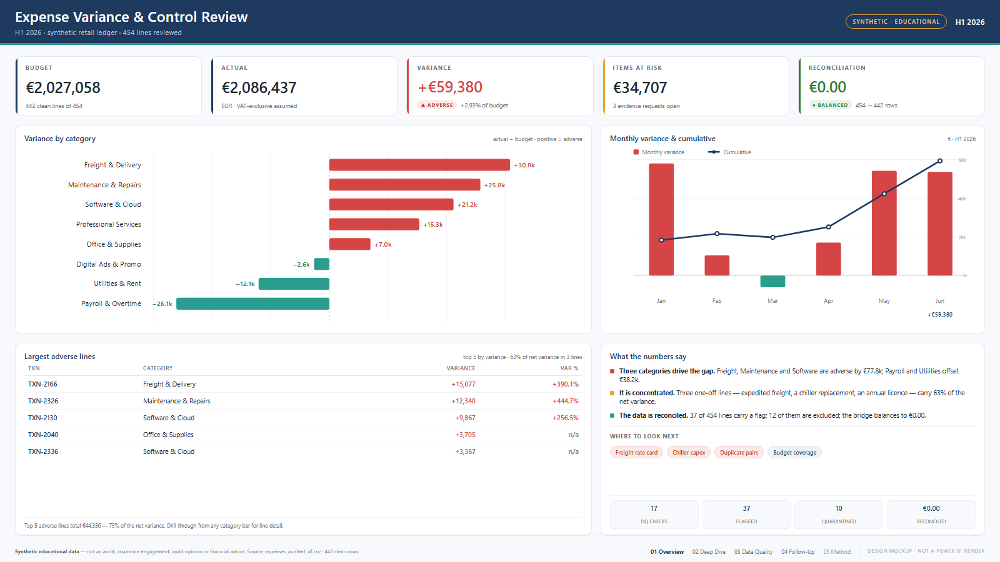

# Power BI Build Guide — Expense Variance & Control Review

> **Boundary.** This is an educational portfolio exercise on clearly labelled
> **synthetic** retail data. It is **not** a statutory audit, assurance
> engagement, audit opinion or financial advice. No conclusion on fraud, error or
> management performance is drawn. Every report page must carry the synthetic-data
> disclaimer.

| | |
|---|---|
| Report | Expense Variance & Control Review — H1 2026 |
| Dataset | 454 synthetic expense lines · 442 clean · €2.09M actual |
| Audience | Finance leadership, internal audit, portfolio reviewers |
| Tool | Power BI Desktop (Windows), Import mode |
| Companion files | [`DAX_MEASURES.md`](DAX_MEASURES.md) · [`theme_expense_review.json`](theme_expense_review.json) · [`data/`](data/) |
| Status | Guide complete. The `.pbix` is authored locally in Power BI Desktop — see [§12](#12-what-this-guide-does-not-do). |

---

## 0. Quick start (the 90-minute path)

If you only read one section, read this.

1. Open Power BI Desktop → **Home → Get data → Text/CSV** →
   `data/processed/expenses_audited_all.csv` → **Transform Data**.
2. Rename and type the 15 columns using the map in [§5.3](#53-clean-and-type-the-fact-table).
3. **Close & Apply**. Create `DimDate` with the DAX in [§5.5](#55-build-dimdate).
4. Add the three small dimensions with **Enter data** ([§5.6](#56-build-the-small-dimensions)).
5. Create the four relationships in [§5.7](#57-model-relationships-and-settings).
6. Paste the core measures from [§5.8](#58-create-the-measures) (full library in
   [`DAX_MEASURES.md`](DAX_MEASURES.md)).
7. Import [`theme_expense_review.json`](theme_expense_review.json) via
   **View → Themes → Browse for themes**.
8. Build the four core pages in [§6](#6-page-by-page-build), then verify against
   [§7](#7-verify-every-number).
9. Capture the screenshots in [§9](#9-screenshots-and-portfolio-packaging).

**Design principle:** one question per page, one accent colour per page, and no
number on screen that is not reconciled.

---

## 1. The story you are telling

The report has to do three jobs at once, and most portfolio dashboards only do
the first:

1. **Explain the money.** Spend is €59,380 (2.93%) above a €2.03M budget, but the
   overspend is not uniform. Three categories are adverse by €77,794 while Payroll
   and Utilities are favourable by €38,182. Three one-off lines carry 63% of the
   *net* variance. A single "we overspent by 3%" headline is technically true and
   analytically useless.
2. **Show the data can be trusted.** 454 raw lines become 442 clean lines through
   a five-way disposition, 17 checks and a reconciliation bridge that balances to
   €0.00. The report must make that visible, not hide it.
3. **Separate signal from conclusion.** The three follow-ups are **evidence
   requests**, not findings. The dashboard must say what is known, what is
   unknown, and what evidence would change the answer.

The narrative arc across pages is therefore:

> **What happened → where it happened → can we trust the numbers → what we are
> asking for → how the numbers were produced.**

That arc is why the report is four core pages plus an appendix, not a gallery of
charts.

---

## 2. Recommended report architecture

### 2.1 Page map

| # | Page | Question it answers | Primary visuals | Audience |
|---|---|---|---|---|
| 1 | **Executive Overview** | How big is the gap, where is it, and is the data sound? | 5 KPI cards · category bar · monthly variance + cumulative · top-5 lines · narrative | Executives, hiring managers |
| 2 | **Variance Deep Dive** | Which category × month cells and which lines drive it? | Category × month heatmap · decomposition tree · top-15 line table · waterfall | FP&A, finance business partners |
| 3 | **Data Quality & Controls** | What was wrong with the data, and which controls can we actually test? | Check-hit bar · disposition mix · control-test scorecard · risk-testability matrix | Internal audit, data governance |
| 4 | **Follow-Up & Actions** | What are we asking for, from whom, and what would change the conclusion? | 3 follow-up cards · evidence checklist · priority risk table | Audit, controllership |
| 5 | **Method & Verification** *(appendix)* | How was every number produced, and does it reconcile? | Reconciliation bridge · validation cards · definitions · limitations | Reviewers, anyone checking the work |

### 2.2 Why this structure

- **Four core pages, not seven.** Each page answers one question. A fifth
  analytical page (department view, scatter, small multiples) adds pixels but not
  decisions; department variance is better used as a slicer on page 2.
- **The data-quality page is not an appendix.** In a real review, the credibility
  of the variance depends on the exclusions. Putting DQ on page 3, before the
  recommendations, makes that argument in the right order.
- **The appendix is visible but de-emphasised.** Reviewers need the reconciliation
  and definitions; executives do not. Keep it as the last page with a muted nav
  style rather than hiding it, so the work is auditable.
- **No pie charts, gauges, maps or 3D.** None of them answer a question this
  dataset poses. A donut is used once, on page 3, for a five-part composition
  where the parts sum to 454 — and even there a bar would be defensible.
- **One accent per page.** Red is reserved for adverse variance and hard
  exceptions; teal for favourable and verified; amber for "flagged / needs
  review"; grey for excluded/neutral. If everything is coloured, nothing is.

### 2.3 What to leave out (and why)

| Tempting visual | Why not |
|---|---|
| Budget-vs-actual gauge | A gauge encodes one number twice and hides the category mix. Use a KPI card + bar. |
| Map of stores | No store geography in the data; inventing one would be fabrication. |
| 12-month trend | Only H1 2026 exists. A trend line beyond June would be fake. |
| Forecast / AI "insights" | No time series long enough to forecast responsibly; the decomposition tree is the honest "AI" visual. |
| Fraud/risk score | The data cannot support a score. The risk matrix is qualitative and explicitly not a conclusion. |

---

## 3. Design system

### 3.1 Palette

A restrained navy/teal executive palette. Hex values match
[`theme_expense_review.json`](theme_expense_review.json).

| Token | Hex | Use | Notes |
|---|---|---|---|
| Navy | `#1F3A5F` | Header band, titles, primary series | 10.9:1 on white — AAA |
| Teal | `#2A9D8F` | Favourable variance, verified/balanced | 3.4:1 on white — use for fills, not small text |
| Coral | `#D64545` | Adverse variance, hard exceptions | 4.3:1 on white — pair with a ▲ label |
| Amber | `#E9A23B` | Flagged / needs review | Never the only signal; add text |
| Slate | `#6B7280` | Excluded, neutral, secondary text | 4.8:1 on white |
| Canvas | `#F7F9FC` | Page background | |
| Card | `#FFFFFF` | KPI and visual cards | 1px `#E3E8EF` border |
| Text | `#1F2933` | Body text | 14.7:1 on white |
| Good | `#2E7D32` | "BALANCED", pass | Darker than teal for text legibility |
| Bad | `#C0392B` | Fail, hard error | Darker than coral for text legibility |

**Rules**

- Red/green are never the only encoding. Every variance also carries a sign and
  an arrow (`▲ +€15,077`), so the report survives greyscale printing and
  red-green colour blindness.
- Do not use coral for decoration. If a tile is coral, it is adverse.
- Keep the canvas light. A dark theme looks striking in a screenshot and fails on
  a projector.

### 3.2 Typography

| Role | Font | Size | Weight |
|---|---|---|---|
| Report title | Segoe UI Semibold | 26 px | 600 |
| Page title | Segoe UI Semibold | 20 px | 600 |
| Visual title | Segoe UI Semibold | 13 px | 600 |
| KPI value | Segoe UI Semibold | 28–32 px | 600 |
| KPI label | Segoe UI | 10 px, uppercase, letter-spaced | 600 |
| Body / table | Segoe UI | 10–11 px | 400 |
| Footnote | Segoe UI | 8 px | 400 |

Use **one** font family. Segoe UI is the Power BI default on Windows and renders
correctly in the Service.

### 3.3 Layout grid

- Canvas: **1600 × 900** (16:9). Also set a mobile layout.
- Outer margin: **24 px**. Gutter: **16 px**. Baseline: **8 px**.
- Header band: **72 px**. Footer band: **40 px**.
- Content area: **1600 − 48 = 1552 px** wide.
- Five KPI cards: `(1552 − 4×16) / 5 = 297.6 px` each.
- Two-column split: **60 / 40** for analytical pages, **55 / 45** for the
  executive page.

### 3.4 Visual rules

1. **Titles are sentences, not field names.** "Variance by category" not
   "Sum of Variance EUR by Category".
2. **Data labels on.** At 442 rows the numbers fit; tooltips are a supplement,
   not a substitute.
3. **Sort by the measure, not alphabetically.** Category bars sort by variance
   descending; the heatmap keeps a stable category order.
4. **Zero line always visible** on variance charts.
5. **Max two series** on a combo chart, and only when the second is a different
   unit (monthly € vs cumulative €).
6. **Tables over matrices** when there are fewer than ~8 rows.
7. **No scroll bars on the canvas.** If a visual scrolls, it is too small or the
   page has too much on it.
8. **Every page footer** carries the boundary line and the data source.
9. **Blank is not zero.** `Variance %` is blank when budget < €100; show `n/a`,
   never `0%`.
10. **Sign convention is fixed:** positive variance = adverse. Never flip it
    between pages.

### 3.5 Accessibility

- Add **alt text** to every visual (Format → General → Alt text).
- Set a **tab order** per page (Selection pane → Tab order).
- Do not encode status by colour alone; pair with text ("BALANCED", "▲ adverse").
- Minimum 10 px text for anything a reader must read; 8 px only for footnotes.
- Check the report in **grayscale** before publishing.

---

## 4. Data model

### 4.1 Grain

`FactExpenses` is **one row per transaction line** (`Txn ID`). 454 rows, of which
442 are included in the clean ledger. Never aggregate before loading; all
variance is computed from line level so the report can drill to a transaction.

### 4.2 Tables

| Table | Type | Rows | Role |
|---|---|---|---|
| `FactExpenses` | Fact | 454 | Budget, actual, line variance, disposition, flags |
| `DimDate` | Dimension (calculated) | 181 | Jan–Jun 2026; marked as date table |
| `DimCategory` | Dimension (entered) | 8 | Category, analyst group, sort order, colour |
| `DimDepartment` | Dimension (entered) | 5 | Department, short name, sort order |
| `DimDisposition` | Dimension (entered) | 5 | Disposition label, severity, included flag |
| `DQSummary` | Standalone | 17 | One row per data-quality check |
| `DQExceptions` | Standalone | 37 | One row per flagged transaction |
| `Reconciliation` | Standalone | 7 | Raw → excluded → clean bridge |
| `ControlTests` | Standalone | 9 | T01–T09 scorecard |
| `RiskMatrix` | Standalone | 9 | Risk, control, testability, priority |
| `SelectedFollowUps` | Standalone | 3 | The three evidence requests |

### 4.3 Relationships

```
                    ┌──────────────┐
                    │   DimDate    │
                    │  Date (PK)   │
                    └──────┬───────┘
                           │ 1
                           │
                           │ *
┌──────────────┐    ┌──────┴───────────────┐    ┌──────────────────┐
│ DimCategory  │1  *│     FactExpenses     │*  1│ DimDepartment    │
│ Category(PK) ├────┤ Txn ID (grain)       ├────┤ Department (PK)  │
└──────────────┘    │ Date                 │    └──────────────────┘
                    │ Category             │
                    │ Department           │
                    │ Disposition          │
                    │ Budget / Actual      │
                    │ Included             │
                    └──────┬───────────────┘
                           │ *
                           │ 1
                    ┌──────┴───────────────┐
                    │  DimDisposition      │
                    │  Disposition (PK)    │
                    └──────────────────────┘

Standalone (no relationships): DQSummary · DQExceptions · Reconciliation ·
ControlTests · RiskMatrix · SelectedFollowUps
```

All relationships are **single-direction** (`Dim → Fact`) with **one-to-many**
cardinality. No bidirectional filters are needed at this size, and enabling them
would create ambiguous filter paths.

### 4.4 Why the support tables are standalone

- `DQSummary` has one row per *check*, not per transaction. Joining it to the
  fact would multiply rows (a transaction can fail several checks).
- `DQExceptions` duplicates 37 fact rows. Joining it would double-count those
  transactions on financial pages.
- `Reconciliation`, `ControlTests`, `RiskMatrix` and `SelectedFollowUps` are
  reference/scorecard tables with no transaction key. They are displayed as
  tables, not sliced by date.

Keeping them standalone makes double-counting impossible. The cost is that they
cannot be cross-filtered by the page slicers — which is correct, because a
"March" filter should not change how many checks exist.

### 4.5 Storage mode

**Import.** 454 rows is trivial. Import gives the fastest visuals and works
offline. DirectQuery adds latency and complexity with no benefit here.

Before loading, disable **Auto date/time** (File → Options and settings →
Options → Current file → Data load → uncheck *Auto date/time*). Otherwise Power
BI creates a hidden date table per date column and clutters the model.

### 4.6 Field naming contract

Full map in [`DAX_MEASURES.md` §0](DAX_MEASURES.md#0-naming-contract). The
essential point: **column names and measure names must not collide.**

| CSV column | Rename to | Type |
|---|---|---|
| `txn_id` | `Txn ID` | Text |
| `date` | `Date` | Date |
| `month` | `Month` | Text |
| `department` | `Department` | Text |
| `category` | `Category` | Text |
| `category_raw` | `Category Raw` | Text |
| `description` | `Description` | Text |
| `budget` | `Budget` | Decimal |
| `actual_amount` | `Actual` | Decimal |
| `variance_eur` | `Line Variance` | Decimal |
| `variance_pct` | `Line Variance % (pts)` | Decimal |
| `disposition` | `Disposition` | Text |
| `dq_flags` | `DQ Flags` | Text |
| `needs_review` | `Needs Review` | True/False |
| `included` | `Included` | True/False |

Measures use `Variance EUR`, `Variance %`, `Total Budget`, `Total Actual`. The
column keeps `Line Variance`; the measure keeps `Variance EUR`. No `Variance EUR 2`.

---

## 5. Build, step by step

### 5.1 Create the file and set the canvas

1. **File → New**. Save immediately as
   `power_bi/expense_variance_control_review.pbix`.
2. **File → Options and settings → Options → Current file → Data load** →
   uncheck **Auto date/time**.
3. **View → Page view → Actual size**, then set **Canvas settings → 16:9**.
4. In **Format page → Canvas background**, set `#F7F9FC`.
5. **View → Gridlines** on, **Snap to grid** on, grid size 8 px.
6. Rename the page `01 · Executive Overview`.

### 5.2 Load the fact table

1. **Home → Get data → Text/CSV** →
   `data/processed/expenses_audited_all.csv`.
2. Check the preview: 15 columns, 454 rows, UTF-8.
3. Click **Transform Data** (do not load yet).

> If the file picker mangles accented characters, choose **File origin →
> 65001: Unicode (UTF-8)** in the dialog.

### 5.3 Clean and type the fact table

In Power Query:

1. **Home → Use first row as headers** (if not already promoted).
2. Rename the 15 columns per [§4.6](#46-field-naming-contract). Double-click each
   header.
3. Set data types:

| Column | Type |
|---|---|
| Txn ID, Month, Department, Category, Category Raw, Description, Disposition, DQ Flags | Text |
| Date | Date |
| Budget, Actual, Line Variance, Line Variance % (pts) | Decimal Number |
| Needs Review, Included | True/False |

4. `Date` already arrives as `null` for the 7 undated rows — leave it null. Do
   **not** replace nulls with a placeholder date; that would silently move
   quarantined rows into a month.
5. `Line Variance % (pts)` is already in percentage points (e.g. `-3.67` means
   −3.67%). Keep it as a decimal number; format it as `0.00"%"` in the model, not
   by dividing by 100.
6. Add a clean flag column for readability:
   **Add Column → Custom Column**, name `Row Status`,
   formula `if [Included] then "Clean" else "Excluded"`.
7. Rename the query `FactExpenses`.
8. **Home → Close & Apply**.

**Optional M snippet** if you prefer to paste the whole transformation:

```m
let
    Source = Csv.Document(
        File.Contents("data/processed/expenses_audited_all.csv"),
        [Delimiter = ",", Encoding = 65001, QuoteStyle = QuoteStyle.Csv]
    ),
    Promoted = Table.PromoteHeaders(Source, [PromoteAllScalars = true]),
    Typed = Table.TransformColumnTypes(
        Promoted,
        {
            {"txn_id", type text}, {"date", type date}, {"month", type text},
            {"department", type text}, {"category", type text},
            {"category_raw", type text}, {"description", type text},
            {"budget", type number}, {"actual_amount", type number},
            {"variance_eur", type number}, {"variance_pct", type number},
            {"disposition", type text}, {"dq_flags", type text},
            {"needs_review", type logical}, {"included", type logical}
        }
    ),
    Renamed = Table.RenameColumns(
        Typed,
        {
            {"txn_id", "Txn ID"}, {"date", "Date"}, {"month", "Month"},
            {"department", "Department"}, {"category", "Category"},
            {"category_raw", "Category Raw"}, {"description", "Description"},
            {"budget", "Budget"}, {"actual_amount", "Actual"},
            {"variance_eur", "Line Variance"}, {"variance_pct", "Line Variance % (pts)"},
            {"disposition", "Disposition"}, {"dq_flags", "DQ Flags"},
            {"needs_review", "Needs Review"}, {"included", "Included"}
        }
    ),
    WithStatus = Table.AddColumn(
        Renamed, "Row Status", each if [Included] then "Clean" else "Excluded", type text
    )
in
    WithStatus
```

### 5.4 Load the support tables

Use **Home → Get data → Text/CSV** six times:

| File | Query name |
|---|---|
| `data/processed/dq_summary.csv` | `DQSummary` |
| `data/processed/dq_exceptions_log.csv` | `DQExceptions` |
| `data/processed/reconciliation.csv` | `Reconciliation` |
| `power_bi/data/control_tests.csv` | `ControlTests` |
| `power_bi/data/risk_matrix.csv` | `RiskMatrix` |
| `power_bi/data/selected_follow_ups.csv` | `SelectedFollowUps` |

For each: **Use first row as headers**, set numeric columns to Decimal Number,
then **Close & Apply**. Do not create relationships for these.

> `DQExceptions` has the same 15 columns as the fact table. Rename them
> identically (`Txn ID`, `DQ Flags`, `Actual`, …) so the detail table reads
> consistently with the rest of the report; it stays standalone, so the shared
> names do not create a relationship.

### 5.5 Build DimDate

**Modeling → New table** and paste:

```dax
DimDate =
VAR StartDate = DATE ( 2026, 1, 1 )
VAR EndDate   = DATE ( 2026, 6, 30 )
RETURN
ADDCOLUMNS (
    CALENDAR ( StartDate, EndDate ),
    "Year", YEAR ( [Date] ),
    "Month Number", MONTH ( [Date] ),
    "Month", FORMAT ( [Date], "yyyy-MM" ),
    "Month Short", FORMAT ( [Date], "MMM" ),
    "Month Long", FORMAT ( [Date], "MMMM" ),
    "Quarter", "Q" & QUARTER ( [Date] ),
    "Month-Year", FORMAT ( [Date], "MMM yyyy" ),
    "Month Sort", YEAR ( [Date] ) * 100 + MONTH ( [Date] )
)
```

Then:

1. Select `DimDate` → **Table tools → Mark as date table** → column `Date`.
2. Select `Month-Year` → **Column tools → Sort by column → `Month Sort`**.
3. Format `Date` as `dd mmm yyyy`.

> The period is deliberately hard-coded to H1 2026. This is a fixed-period
> review, not a rolling model. If the dataset changes, change the two `DATE()`
> arguments in one place.

### 5.6 Build the small dimensions

Use **Home → Enter data**. Paste each block (tab-separated works best; if your
paste splits on commas, import the equivalent CSV instead). Name the tables
exactly as shown.

**`DimCategory`**

```
Category	Category Group	Sort Order	Colour
Payroll & Overtime	People	1	#1F3A5F
Utilities & Rent	Property	2	#2A9D8F
Freight & Delivery	Supply Chain	3	#D64545
Maintenance & Repairs	Property	4	#E9A23B
Professional Services	Commercial	5	#6B7280
Software & Cloud	Technology	6	#3E7CB1
Office & Supplies	Operations	7	#8AB17D
Digital Ads & Promo	Commercial	8	#B56576
```

> `Category Group` is an **analyst construct**, not a source field. It groups the
> eight categories into six lenses for the executive page. State that in the
> appendix; do not present it as a management structure.

**`DimDepartment`**

```
Department	Department Short	Sort Order
Store Operations	Store Ops	1
Logistics & Supply	Logistics	2
Finance & Admin	Finance	3
Marketing	Marketing	4
IT & Systems	IT	5
```

**`DimDisposition`**

```
Disposition	Disposition Label	Severity	Included Flag	Description	Colour
INCLUDE	Included	1	TRUE	Passes all checks	#2E7D32
CORRECT_AND_INCLUDE	Corrected and included	2	TRUE	Fixable defect corrected with a logged before/after value	#2A9D8F
INCLUDE_FLAGGED	Included and flagged	3	TRUE	Retained in the clean ledger but needs review	#E9A23B
QUARANTINE	Quarantined	4	FALSE	Cannot be validated and is excluded from the clean ledger	#C0392B
EXCLUDE_OUT_OF_PERIOD	Out of period	5	FALSE	Dated outside H1 2026 and excluded	#6B7280
```

Set `Severity` to Whole Number and `Included Flag` to True/False.

### 5.7 Model relationships and settings

In **Model view**:

1. Drag `DimDate[Date]` onto `FactExpenses[Date]`. Confirm **1 to many (\*)**,
   single direction, active.
2. Drag `DimCategory[Category]` → `FactExpenses[Category]`.
3. Drag `DimDepartment[Department]` → `FactExpenses[Department]`.
4. Drag `DimDisposition[Disposition]` → `FactExpenses[Disposition]`.
5. Leave every support table unconnected.

Then tidy the model:

| Action | Why |
|---|---|
| Hide `FactExpenses[Month]` | `DimDate` is the month axis; two month fields confuse report authors |
| Hide `FactExpenses[Date]` from Report view | Use `DimDate[Date]` in slicers |
| Hide `DimDate[Month Sort]` | Sorting helper only |
| Set `DimCategory[Sort Order]` to sort `Category`? | No — sort the *visual* by measure. Sort order is for legends. |
| Format `Budget`, `Actual`, `Line Variance` as `€#,##0.00` | Currency consistency |
| Format `Line Variance % (pts)` as `0.00"%"` | It is already points, not a fraction |
| Set `DimDisposition[Severity]` as sort column for `Disposition Label` | Legend order |
| Set summarisation of `Txn ID` to **Don't summarize** | It is an identifier |
| Set summarisation of `DQ Flags` to **Don't summarize** | Text |

### 5.8 Create the measures

Create a dedicated table to hold measures: **Modeling → New table** →
`_Measures = { BLANK () }`, then hide its only column. This keeps measures out of
the fact table and makes the field list readable.

Paste the core measures below, then add the rest from
[`DAX_MEASURES.md`](DAX_MEASURES.md).

```dax
Total Budget =
CALCULATE ( SUM ( FactExpenses[Budget] ), FactExpenses[Included] = TRUE )

Total Actual =
CALCULATE ( SUM ( FactExpenses[Actual] ), FactExpenses[Included] = TRUE )

Variance EUR = [Total Actual] - [Total Budget]

Variance % =
IF ( [Total Budget] >= 100, DIVIDE ( [Variance EUR], [Total Budget] ), BLANK () )

Rows Raw = COUNTROWS ( FactExpenses )

Rows Included =
CALCULATE ( COUNTROWS ( FactExpenses ), FactExpenses[Included] = TRUE )

Rows Flagged =
CALCULATE ( COUNTROWS ( FactExpenses ), FactExpenses[Disposition] = "INCLUDE_FLAGGED" )

Rows with DQ Flags =
CALCULATE (
    DISTINCTCOUNT ( FactExpenses[Txn ID] ),
    FactExpenses[DQ Flags] <> "CLEAN"
)

Reconciliation Gap =
VAR Raw      = CALCULATE ( SUM ( FactExpenses[Budget] ) )
VAR Excluded = CALCULATE ( SUM ( FactExpenses[Budget] ), FactExpenses[Included] = FALSE )
VAR Clean    = [Total Budget]
RETURN Raw - Excluded - Clean
```

Set formats:

| Measure | Format |
|---|---|
| Total Budget, Total Actual | `€#,##0` |
| Variance EUR | `+€#,##0; -€#,##0; €0` |
| Variance % | `+0.0%; -0.0%; 0.0%` |
| Rows * | `#,##0` |
| Reconciliation Gap | `€#,##0.00; -€#,##0.00; €0.00` |

Add the **validation measures** now — they are the spine of §7:

```dax
Budget Check        = [Total Budget] - 2027057.54
Actual Check        = [Total Actual] - 2086437.42
Variance Check      = [Variance EUR] - 59379.88
Included Rows Check = [Rows Included] - 442
Flagged Rows Check  = [Rows with DQ Flags] - 37
Control Tests Check = COUNTROWS ( ControlTests ) - 9
```

Every one must display `0` / `0.00`. If not, stop and fix the model.

### 5.9 Apply the theme

1. **View → Themes → Browse for themes** →
   [`theme_expense_review.json`](theme_expense_review.json).
2. Power BI applies a **subset** of the JSON (data colours, background,
   foreground, table accent, good/neutral/bad). The `textClasses` block may be
   partially honoured depending on version — verify titles after import and set
   any that did not apply manually.
3. Set **Format page → Page background** to `#F7F9FC` if the theme does not.
4. Set default visual border: 1 px, `#E3E8EF`, radius 8 px.

---

## 6. Page-by-page build

Shared elements, built once and copied:

- **Header band** (72 px): rectangle `#1F3A5F`, full width; title text box left;
  a right-aligned pill "SYNTHETIC · EDUCATIONAL DATA" (amber text on transparent,
  1 px amber border); page title in white 20 px.
- **Footer band** (40 px): 8 px text, `#6B7280`:
  *"Synthetic educational data — not an audit, assurance engagement, audit
  opinion or financial advice. Source: expenses_audited_all.csv (442 clean
  rows)."*
- **Nav rail**: **Insert → Buttons → Navigator → Page navigator**, styled as
  text buttons, current page in navy bold. Place bottom-left in the footer band.

### 6.1 Page 1 — Executive Overview

**Purpose:** a reader who looks for five seconds should know the size of the gap,
its concentration, and whether the data is trustworthy.

**Wireframe**

```
┌────────────────────────────────────────────────────────────────────────────┐
│ Expense Variance & Control Review          [SYNTHETIC · EDUCATIONAL]  H1 26 │
├────────────┬────────────┬────────────┬────────────┬──────────────────────────┤
│ BUDGET     │ ACTUAL     │ VARIANCE   │ AT RISK    │ RECONCILIATION           │
│ €2,027,058 │ €2,086,437 │ +€59,380   │ €34,707    │ €0.00   ● BALANCED       │
│ 442 lines  │ vs budget  │ +2.93% ▲   │ 3 open     │ 454 → 442               │
├────────────┴────────────┴────────────┴────────────┴──────────────────────────┤
│ Variance by category (60%)            │ Monthly variance + cumulative (40%) │
│  Freight      ███████████ +30.8k      │   ▁▂▁▂▃▃ columns                   │
│  Maintenance  █████████   +25.8k      │   ╱╱╱╱╱╱ cumulative line            │
│  Software     ███████     +21.2k      │                                     │
│  ...          ██          −26.1k      │                                     │
├───────────────────────────────────────┼─────────────────────────────────────┤
│ Largest adverse lines (55%)           │ What the numbers say (45%)          │
│  TXN-2166 Freight      +15,077 390%   │  • Three categories = +€77.8k       │
│  TXN-2326 Maintenance  +12,340 445%   │  • Payroll/Utilities offset −€38.2k │
│  TXN-2130 Software      +9,867 256%   │  • 37 flagged rows; bridge = €0.00  │
│  TXN-2040 Office        +3,705  n/a   │  Where to look →                   │
│  TXN-2336 Software      +3,367  n/a   │  Freight · Maintenance · Duplicates │
└───────────────────────────────────────┴─────────────────────────────────────┘
```

**Visual specification**

| # | Visual | Type | Fields / wells | Format notes |
|---|---|---|---|---|
| 1 | KPI Budget | Card | `[Total Budget]` | Label "BUDGET", sub-label "442 clean lines" |
| 2 | KPI Actual | Card | `[Total Actual]` | Sub-label "vs €2.03M budget" |
| 3 | KPI Variance | Card | `[Variance EUR]`, `[Variance %]` | Coral; `▲` prefix; sub-label "+2.93% adverse" |
| 4 | KPI At risk | Card | `[Follow-up Amount at Risk]` | Amber; sub-label "3 evidence requests open" |
| 5 | KPI Reconciliation | Card + text | `[Reconciliation Gap]`, `[Reconciliation Status]` | Green `BALANCED` pill; sub-label "454 → 442 rows" |
| 6 | Category variance | Clustered bar (horizontal) | Axis `DimCategory[Category]`; Value `[Variance EUR]` | Sort by value desc; diverging colours; data labels `+€#,##0`; zero line |
| 7 | Monthly variance | Line and clustered column | X `DimDate[Month-Year]`; Column `[Variance EUR]`; Line `[Cumulative Variance]` | Columns coral/teal by sign; line navy dashed; secondary axis for cumulative |
| 8 | Top adverse lines | Table | `Txn ID`, `Category`, `Description`, `[Variance EUR]`, `[Variance %]` | Top N filter: Top 5 by `[Variance EUR]`; data bars on variance |
| 9 | Narrative | Text box | Static text + `[Top Finding]` measure | 3 bullets max; 11 px |
| 10 | Slicers | Slicer panel | `DimDate[Month-Year]`, `DimCategory[Category]`, `DimDepartment[Department]` | Collapsible panel; see §8.1 |

**Build steps**

1. Place the header and footer bands.
2. Insert five cards across the top; apply formats and labels.
3. Add the category bar chart. Set **Sort visual by `[Variance EUR]` descending**.
   Add a conditional colour rule: `[Variance EUR] > 0` → `#D64545`, else
   `#2A9D8F`.
4. Add the combo chart. Put `[Variance EUR]` on Columns and `[Cumulative Variance]`
   on Line, then **turn on secondary axis** for the line only.
5. Add the table. Use **Filters on this visual → Top N → Top 5 by `[Variance EUR]`**.
6. Add the narrative text box and, if you want it dynamic, insert the
   `[Top Finding]` measure as a card with no background.
7. Add the slicers in a right-hand panel; group them and add a bookmark-driven
   show/hide (see §8.1).

**Interactions**

- Clicking a category bar filters the monthly chart and the line table
  (default cross-filter). Keep it.
- Clicking a month should filter the category chart but **not** the cumulative
  line (cumulative is intentionally period-to-date). Set
  **Format → Edit interactions → cumulative visual → None** for the month
  slicer if you want the line to stay whole-period. Document the choice.
- Drill-through: right-click a category → **Drill through → Line detail**.

**Acceptance check**

- [ ] Variance card reads `+€59,380` and `+2.93%`.
- [ ] Reconciliation card reads `€0.00` and `BALANCED`.
- [ ] Category bars sum to `+€59,380` (allow rounding).
- [ ] Top-5 table shows TXN-2166 first.
- [ ] No visual scrolls; all five cards fit at 1600 × 900.

---

### 6.2 Page 2 — Variance Deep Dive

**Purpose:** move from "where" to "which cell and which line", and let a reviewer
decompose the variance themselves.

**Wireframe**

```
┌────────────────────────────────────────────────────────────────────────────┐
│ Variance Deep Dive                         [SYNTHETIC · EDUCATIONAL]       │
│ Month ▾   Category ▾   Department ▾                         [Reset filters]│
├──────────────────────────────────────────────┬─────────────────────────────┤
│ Category × month heatmap (60%)               │ Decomposition tree (40%)    │
│        Jan   Feb   Mar   Apr   May   Jun     │ Variance EUR                │
│ Freight +3.7  +3.5  +3.4  +3.6  −4.7 +21.3    │  ├ Freight        +30.8k    │
│ Maint  +14.1  ...                            │  │  ├ Store Ops   +…        │
│ Soft   ...                                   │  │  └ Logistics   +…        │
│ Payroll −7.5 −5.6 ...                        │  ├ Maintenance    +25.8k    │
├──────────────────────────────────────────────┼─────────────────────────────┤
│ Top lines — [Adverse | Favourable] toggle    │ Waterfall: budget → actual  │
│  Txn     Category      Budget  Actual  Var   │  Budget ██████████ 2,027k   │
│  TXN-2166 Freight      3,865  18,943 +15,077 │   +Freight  ██ +30.8k       │
│  ...                                         │   +Maint    ██ +25.8k       │
│                                              │   −Payroll  ██ −26.1k       │
│                                              │  Actual  ██████████ 2,086k  │
└──────────────────────────────────────────────┴─────────────────────────────┘
```

**Visual specification**

| # | Visual | Type | Fields / wells | Format notes |
|---|---|---|---|---|
| 1 | Heatmap | Matrix | Rows `DimCategory[Category]`; Columns `DimDate[Month-Year]`; Values `[Variance EUR]` | Background colour scale: min `#2A9D8F`, mid `#FFFFFF`, max `#D64545`; data labels `+€#,##0`; row/column totals on |
| 2 | Variance % matrix *(optional, toggle)* | Matrix | Same axes; Values `[Variance %]` | Diverging scale; blanks as `n/a` |
| 3 | Decomposition tree | Decomposition tree | Analyze `[Variance EUR]`; Explain by `DimCategory[Category]`, `DimDepartment[Department]`, `FactExpenses[Txn ID]` | "High value" only; disable "AI splits" if you want deterministic output |
| 4 | Top lines | Table | `Txn ID`, `Date`, `Category`, `Description`, `[Total Budget]`*, `[Total Actual]`*, `[Variance EUR]`, `[Variance %]` | Top N 15; data bars; conditional font colour |
| 5 | Waterfall | Waterfall | Category `DimCategory[Category]`; Y `[Variance EUR]` | Breakdown only (budget→actual bridge) or category contributions; label ends |
| 6 | Month slicer | Slicer | `DimDate[Month-Year]` | Tile style; multi-select |
| 7 | Category slicer | Slicer | `DimCategory[Category]` | Dropdown; search on |
| 8 | Department slicer | Slicer | `DimDepartment[Department]` | Dropdown |
| 9 | Reset button | Button | Bookmark "Clear filters" | Top-right |

\* For a line-level table, `[Total Budget]` and `[Total Actual]` respect the
`Included` filter and return the line's values when `Txn ID` is on rows. If you
prefer to show raw line values regardless of the included filter, use
`SUM ( FactExpenses[Budget] )` directly in the table — but then the total will
include excluded rows. Keep the measures for consistency.

**Build steps**

1. Add the three slicers in a strip under the header. Set **Selection controls →
   Show "Clear selection"** on each.
2. Build the matrix. Add `[Variance EUR]` to Values. **Format → Cell elements →
   Background colour → Conditional formatting → Gradient**, min `#2A9D8F`,
   midpoint `#FFFFFF` at 0, max `#D64545`.
3. Turn on **Row subtotals** and **Column subtotals**.
4. Add the decomposition tree. Set **Explain by** to the three fields. Expand
   Freight and Maintenance once so the screenshot shows a real path.
5. Add the top-lines table and a **Top N 15** visual filter. Create two bookmarks
   — "Adverse" (sort desc) and "Favourable" (sort asc) — and a toggle button
   group. If you prefer a single control, use a **field parameter** for the sort
   column.
6. Add the waterfall. Use `DimCategory[Category]` as Category and
   `[Variance EUR]` as Y. Set **Format → Breakdown** on, so the first and last
   columns are totals.
7. Create the **Line detail** drill-through page (§8.3).

**Interactions**

- Slicers filter all visuals on the page.
- Matrix cell → right-click → drill through to **Line detail**.
- Decomposition tree → click a bar to expand; the table below does **not**
  follow (standalone visual) unless you set **Edit interactions → Filter**.
  Recommended: let the table follow the tree so the reader can see the lines
  behind a node.

**Acceptance check**

- [ ] Matrix grand total = `+€59,380`.
- [ ] The June × Freight cell reads `+€21,340` (`+44.64%`).
- [ ] January × Maintenance reads `+€14,081` (`+61.74%`).
- [ ] May × Software reads `+€13,754` (`+43.48%`).
- [ ] Top-lines table shows TXN-2166, TXN-2326, TXN-2130 in that order.
- [ ] Waterfall ends at `€2,086,437`.

---

### 6.3 Page 3 — Data Quality & Controls

**Purpose:** prove the clean ledger is clean, and be honest about which controls
the data can and cannot test.

**Wireframe**

```
┌────────────────────────────────────────────────────────────────────────────┐
│ Data Quality & Controls                    [SYNTHETIC · EDUCATIONAL]       │
├──────────┬──────────┬──────────┬──────────┬────────────────────────────────┤
│ 17       │ 13       │ 37       │ 10       │ 39 hits / 37 rows              │
│ checks   │ triggered│ flagged  │ quarant. │ (a row can fail >1 check)      │
├──────────┴──────────┴──────────┴──────────┴────────────────────────────────┤
│ Rows affected by check (45%)          │ Disposition mix (55%)              │
│  DQ07 Category      ██████ 6          │  ● Included            417         │
│  DQ15 Outlier       █████ 5           │  ● Corrected             7         │
│  DQ02 Near dup      ████ 4            │  ● Included + flagged   18         │
│  DQ03 Missing date  ████ 4            │  ● Quarantined          10         │
│  DQ12 Credit note   ████ 4            │  ● Out of period         2         │
├───────────────────────────────────────┼────────────────────────────────────┤
│ Control test scorecard (55%)          │ Risk testability (45%)             │
│  T01 Duplicates   2 pairs  Exceptions │  Design testable     9/9           │
│  T02 Near dup     4 rows   Exceptions │  Operating testable  0/9 full      │
│  T03 Cut-off      2 rows   Exceptions │  4 partly testable                 │
│  T09 Reconciliation 0.00   Clean      │  Highest priority: duplicates      │
└───────────────────────────────────────┴────────────────────────────────────┘
```

**Visual specification**

| # | Visual | Type | Fields / wells | Format notes |
|---|---|---|---|---|
| 1 | Checks | Card | `[DQ Checks]` | 17 |
| 2 | Triggered | Card | `[Checks Triggered]` | 13 |
| 3 | Flagged rows | Card | `[Rows with DQ Flags]` | 37; sub-label "35 single-flag + 2 double-flag" |
| 4 | Quarantined | Card | `[Rows Quarantined]` | 10; sub-label "€51,542 actual excluded" |
| 5 | Check hits | Card | `[Check Hits]` | 39; sub-label "37 unique rows" |
| 6 | Check-hit bar | Bar (horizontal) | Axis `DQSummary[check_name]`; Value `[Check Hits]`; Legend `DQSummary[disposition]` | Sort desc; data labels; title says "check hits (not additive)" |
| 7 | Disposition mix | Donut | Legend `DimDisposition[Disposition Label]`; Value `[Rows Raw]` | 5 slices; labels + values; centre card `454`; colours from `DimDisposition[Colour]` |
| 8 | Control scorecard | Table | `ControlTests[test_id]`, `test_name`, `exception_rows`, `outcome`, `evidence_gap` | Conditional icon: `Clean` green, `Exceptions found` amber |
| 9 | Testability | 100% stacked bar | Axis `RiskMatrix[design_testable]`; Value count of `risk_id` | Or a simple 3-card strip: 9 design / 0 full operating / 4 partial |
| 10 | Exception detail | Table | `DQExceptions[Txn ID]`, `DQ Flags`, `Disposition`, `Actual` | Filtered to `DQ Flags <> "CLEAN"`; 37 rows; drill-through |
| 11 | Callout | Text box | Static | "Recording tests can be run. Operating-effectiveness tests cannot — there are no payment, PO or approval records." |

**Build steps**

1. Add the five cards. For card 5, use `[Check Hits]` (39) and a sub-label
   "across 37 unique rows" — this pre-empts the obvious "why 39?" question.
2. Build the check-hit bar. Because `DQSummary` is standalone, it is unaffected
   by page slicers. Add a visual-level filter `rows_affected > 0` so the four
   zero-hit checks do not waste space. Keep all 17 visible on the scorecard
   table instead.
3. Build the donut. Set **Format → Detail labels** on, and add a centre text card
   with `[Rows Raw] = 454`.
4. Build the control scorecard from `ControlTests`. Set column widths; wrap
   `evidence_gap`.
5. Build the testability strip. The honest headline is **0 of 9 controls fully
   operating-testable**; 4 are partly testable. Do not round this up.
6. Add the exception detail table and a **Drill through → Exception detail**
   page (optional; the table may be enough).
7. Add the callout text box in the bottom-right corner.

**Interactions**

- The page slicers should **not** filter the standalone scorecards. If you add a
  date slicer, set **Edit interactions → None** for `DQSummary`, `ControlTests`
  and `RiskMatrix` visuals.
- Clicking a disposition slice can cross-filter the exception table if you relate
  `DimDisposition` to `DQExceptions` — **don't**. Use the table's own filter
  instead, to avoid a second relationship path.

**Acceptance check**

- [ ] `[DQ Checks]` = 17; `[Checks Triggered]` = 13.
- [ ] `[Rows with DQ Flags]` = 37; `[Check Hits]` = 39.
- [ ] Donut slices sum to 454 and read 417 / 7 / 18 / 10 / 2.
- [ ] Control scorecard shows T09 `Clean` with 0.00.
- [ ] Testability strip does **not** claim operating effectiveness was tested.

---

### 6.4 Page 4 — Follow-Up & Actions

**Purpose:** turn the analysis into three specific, evidence-based requests —
without alleging anything.

**Wireframe**

```
┌────────────────────────────────────────────────────────────────────────────┐
│ Follow-Up & Actions                        [SYNTHETIC · EDUCATIONAL]       │
├──────────────┬──────────────┬──────────────┬───────────────────────────────┤
│ 3            │ €34,707      │ 3            │ 0                             │
│ requests     │ at risk      │ evidence req.│ conclusions                   │
├──────────────┴──────────────┴──────────────┴───────────────────────────────┤
│ ┌────────────────────┐ ┌────────────────────┐ ┌──────────────────────────┐ │
│ │ 01 Expedited air   │ │ 02 Chiller         │ │ 03 Duplicate pair        │ │
│ │ freight            │ │ replacement        │ │                          │ │
│ │ TXN-2166           │ │ TXN-2326           │ │ TXN-2364/2451 · 2348/2452│ │
│ │ +€15,077 · +390%   │ │ +€12,340 · +445%   │ │ €7,289 at risk           │ │
│ │ [EVIDENCE REQUESTED│ │ [EVIDENCE REQUESTED│ │ [EVIDENCE REQUESTED]     │ │
│ │ Observation …      │ │ Observation …      │ │ Observation …            │ │
│ │ Evidence needed …  │ │ Evidence needed …  │ │ Evidence needed …        │ │
│ │ Next step …        │ │ Next step …        │ │ Next step …              │ │
│ └────────────────────┘ └────────────────────┘ └──────────────────────────┘ │
├──────────────────────────────────────────────┬─────────────────────────────┤
│ Priority risk actions (55%)                  │ What would change the       │
│  1 Payment-match duplicate pairs             │ conclusion? (45%)           │
│  2 Freight rate card + shipment approval     │  • Two payments vs one      │
│  3 Chiller capital/revenue treatment         │  • Rate-card match          │
│  4 Budget coverage for unbudgeted lines      │  • Asset-register entry     │
└──────────────────────────────────────────────┴─────────────────────────────┘
```

**Visual specification**

| # | Visual | Type | Fields / wells | Format notes |
|---|---|---|---|---|
| 1 | Requests | Card | `[Selected Follow-ups]` | 3 |
| 2 | At risk | Card | `[Follow-up Amount at Risk]` | €34,707.05 |
| 3 | Evidence requested | Card | `[Follow-ups Open]` | 3; sub-label "0 concluded" |
| 4 | Conclusions | Card | `[Follow-ups Concluded]` | 0 |
| 5–7 | Follow-up cards | Card (new) or table row | `SelectedFollowUps[item]`, `transactions`, `variance_eur`, `at_risk_eur`, `status`, `observation` | One card per item; status pill amber; amount coral |
| 8 | Evidence checklist | Table | `SelectedFollowUps[item]`, `evidence_required`, `next_step` | Wrap text; no totals |
| 9 | Priority actions | Table | `RiskMatrix` filtered `priority_rank <= 5`; columns `priority_rank`, `risk`, `proposed_control` | Sort by `priority_rank` |
| 10 | What would change it | Text box | Static bullets per item | 3 bullets max |

**Build steps**

1. Add the four KPI cards.
2. For the three cards, either use the **Card (new)** visual with a
   `SelectedFollowUps` filter per card, or build one table and style it as a
   board. The table is more maintainable; the card looks better. Use cards for
   the hero screenshot and keep a hidden table for accessibility.
3. Add the evidence checklist table. Because `evidence_required` is long, set
   **Wrap text** on and a fixed row height; do not let it scroll.
4. Add the priority-actions table, filtered to the top five risks.
5. Add the "what would change the conclusion" text box. Keep it factual:
   - *Duplicates:* two payments vs one; two invoices and two deliveries.
   - *Freight:* invoiced rate vs rate card; approval for expedited mode.
   - *Chiller:* asset-register entry; capitalisation policy decision.
6. Add a boundary callout at the bottom: **"These are evidence requests, not
   allegations. No conclusion is drawn until the evidence is received."**

**Interactions**

- Clicking a follow-up card can filter the evidence checklist (if both use
  `SelectedFollowUps[item_no]`). This is a nice touch; test that the card
  selection is visible.
- No page slicers needed. This page is a status board.

**Acceptance check**

- [ ] At-risk total = `€34,707.05`.
- [ ] All three statuses read "Evidence requested"; none reads "Concluded".
- [ ] No text asserts error, fraud or misconduct.
- [ ] The boundary callout is visible without scrolling.

---

### 6.5 Page 5 — Method & Verification (appendix)

**Purpose:** make the work auditable. This page is what separates a portfolio
dashboard from a chart gallery.

**Contents**

| Block | Visual | Content |
|---|---|---|
| Reconciliation bridge | Table | `Reconciliation[bucket]`, `rows`, `budget_eur`, `actual_eur`, `variance_eur`; final CHECK row 0.00 |
| Validation cards | 6 cards | `Budget Check`, `Actual Check`, `Variance Check`, `Included Rows Check`, `Flagged Rows Check`, `Control Tests Check` — all 0 |
| Definitions | Text box | Variance = actual − budget; positive = adverse; variance % blank when budget < €100 |
| Dispositions | Table | 5 rows from `DimDisposition` with description |
| Data lineage | Text box | 454 raw → 12 excluded (10 quarantine + 2 out-of-period) → 442 clean |
| Assumptions & limitations | Text box | Synthetic data; VAT-exclusive assumed; no quantity/price; no payment records; H1 only |
| Version | Text box | v1.0 · 2026-11 · source commit |

**Build steps**

1. Add the reconciliation table. Format currency columns; bold the final row.
2. Add six validation cards in a row. Give them a green check icon when the value
   is 0. Because they are measures, they update with the model — if one turns
   non-zero, the page turns red.
3. Add the definitions and limitations text boxes. Copy the wording from
   `docs/methodology.md` and `docs/variance_commentary.md` rather than inventing
   new language.
4. Style the nav button for this page in grey, so it reads as an appendix.

**Acceptance check**

- [ ] Reconciliation CHECK row = 0.00 on rows, budget and actual.
- [ ] All six validation cards = 0.
- [ ] Definitions match `docs/methodology.md`.
- [ ] Limitations mention: synthetic, no payment/PO/approval evidence, H1 only.

---

## 7. Verify every number

Do this before taking a single screenshot. A dashboard with one wrong number is
worse than no dashboard.

### 7.1 Expected values

| Metric | Expected | Where to check | Tolerance |
|---|---:|---|---:|
| Raw rows | 454 | `expenses_audited_all.csv` row count | exact |
| Clean rows | 442 | `included = TRUE` | exact |
| Excluded rows | 12 | 10 quarantine + 2 out-of-period | exact |
| Total budget | €2,027,057.54 | `summary_by_category.csv` total | ±0.01 |
| Total actual | €2,086,437.42 | `summary_by_category.csv` total | ±0.01 |
| Variance | +€59,379.88 | `variance_commentary.md` §2 | ±0.01 |
| Variance % | +2.93% | same | ±0.01 pp |
| Dispositions | 417 / 7 / 18 / 10 / 2 | `expenses_audited_all.csv` | exact |
| DQ checks | 17 | `dq_summary.csv` | exact |
| Checks triggered | 13 | `rows_affected > 0` | exact |
| Check hits | 39 | sum `rows_affected` | exact |
| Unique flagged rows | 37 | `dq_exceptions_log.csv` | exact |
| Quarantine value | €51,542.41 | sum actual, `QUARANTINE` | ±0.01 |
| Out-of-period value | €23,288.60 | sum actual, `EXCLUDE_OUT_OF_PERIOD` | ±0.01 |
| Unbudgeted | 3 rows / €10,421.61 | DQ13 | exact |
| Credit notes | 4 rows / €5,293.69 | DQ12 | exact |
| Exact duplicates | 2 pairs / €7,289.32 | T01 | exact |
| Near duplicates | 2 pairs / 4 rows / €14,459.40 | T02 | exact |
| Control tests | 9 | `ControlTests` | exact |
| Follow-ups | 3 / €34,707.05 | `selected_follow_ups.csv` | exact |
| Reconciliation gap | €0.00 | `Reconciliation Gap` | < €0.005 |

### 7.2 Cross-checks (do all of them)

1. **Category total = grand total.** The eight category variances sum to
   +€59,379.88. If not, a category is unmapped or a relationship is missing.
2. **Month total = grand total.** The six months sum to +€59,379.88.
3. **Department total = grand total.** The five departments sum to +€59,379.88.
4. **Matrix grand total = grand total.** The category × month matrix total must
   equal the category total.
5. **Disposition counts sum to 454.** 417 + 7 + 18 + 10 + 2.
6. **Reconciliation bridge.** Raw − duplicate − missing date − negative budget −
   out of period = clean, on rows, budget and actual.
7. **Check arithmetic.** `[Check Hits]` (39) ≥ `[Rows with DQ Flags]` (37),
   because two rows carry two flags. If you see 35, you are counting single-flag
   rows only. The earlier summary wording conflated the 35 *planted* defects with
   the 37 *flagged* rows; the two are different measures.
8. **Top-lines sum.** The three largest adverse lines sum to €37,284.48, which is
   62.8% of the net variance.
9. **Budget coverage.** 439 of 442 included rows have a budget > 0 (99.3%).
10. **No filter leakage.** Clear every slicer and confirm the cards return to the
    values above.

### 7.3 A ten-minute QA routine

```
1. Clear all slicers.                 -> headline matches §7.1
2. Check page 5 validation cards.     -> all 0
3. Hover every KPI.                   -> tooltip matches card
4. Click each category bar.           -> table + month chart respond
5. Drill through one category.        -> line detail shows only that category
6. Check the matrix total.            -> +59,379.88
7. Check the donut.                   -> 454 total
8. Check the follow-up total.         -> 34,707.05
9. Grayscale check.                   -> signs still readable
10. Resize to 1280x720.               -> no clipped visuals
```

---

## 8. Interactivity and finishing

### 8.1 Collapsible slicer panel

1. Group the three slicers (**Ctrl + click → Group**).
2. **View → Bookmarks → Add** → name it `Filters open`.
3. Hide the group, add another bookmark `Filters closed`.
4. Add a button (**Insert → Buttons → Blank**) labelled "Filters ▾".
5. **Action → Bookmark → Filters open / closed**, and use **Format → Action →
   Type = Bookmark** with a toggle. If your version lacks a toggle, use two
   buttons or a shape overlay.

For most portfolio screenshots, keep the panel **open** so the reader sees the
controls.

### 8.2 Sync slicers

**View → Sync slicers**, then tick the pages that should share each slicer
(`Month-Year`, `Category`, `Department`). Use **Sync** for value and **Visible**
only on pages where the slicer should appear. Do not sync slicers to the
appendix page.

### 8.3 Drill-through page

1. Add a hidden page `Line detail`.
2. In **Visualizations → Drill through**, add `DimCategory[Category]` and
   `FactExpenses[Txn ID]`.
3. Add a table: `Txn ID`, `Date`, `Department`, `Category`, `Description`,
   `Budget`, `Actual`, `Line Variance`, `Line Variance % (pts)`, `DQ Flags`.
4. Add a back button (**Insert → Buttons → Back**).
5. Right-click any category bar → **Drill through → Line detail**.

### 8.4 Tooltip page

1. New page `Line tooltip`, size **Tooltip**.
2. **Format page → Page information → Allow use as tooltip = On**.
3. Add a small card: `Txn ID`, `Description`, `[Variance EUR]`, `[Variance %]`,
   `DQ Flags`.
4. On the table visual, **Format → Tooltip → Report page → Line tooltip**.

### 8.5 Field parameters (optional, high value)

**Modeling → New parameter → Fields** → add `DimCategory[Category]`,
`DimDepartment[Department]`, `DimDate[Month-Year]`. Use the parameter in the
category bar chart's Axis. The reader can switch the breakdown without a second
page. Keep the default on Category for screenshots.

### 8.6 Mobile layout

**View → Mobile layout**. Stack: title → variance card → reconciliation card →
category bar → top lines. Hide the narrative and the appendix. Test at 360 × 640.

### 8.7 Performance

At 454 rows there is no performance problem. Still:

- Keep **Import** mode.
- Remove unused columns in Power Query.
- Avoid bidirectional relationships.
- Turn off **Auto date/time**.
- Do not use `FILTER` over the whole fact table in a measure when a simple
  `CALCULATE` predicate will do.

---

## 9. Screenshots and portfolio packaging

### 9.1 What to capture

| File | Page | Why |
|---|---|---|
| `01_executive_overview.png` | Executive Overview | The hero shot; use it in the README and CV |
| `02_variance_deep_dive.png` | Variance Deep Dive | Proves analytical depth |
| `03_data_quality_controls.png` | Data Quality & Controls | Proves rigour, not just chart-making |
| `04_follow_up_actions.png` | Follow-Up & Actions | Proves judgement and professional scepticism |
| `05_method_verification.png` *(optional)* | Method & Verification | Proves the numbers reconcile |

One hero image plus three supporting images is enough. Five is the maximum
before a reviewer stops scrolling.

### 9.2 How to capture a real Power BI page

Power BI Desktop does not export a page as PNG natively in every version. Use one
of these:

**Option A — Power BI Desktop (fastest)**

1. **View → Page view → Actual size**; zoom to 100%.
2. Click an empty part of the canvas so no visual is selected (removes selection
   borders).
3. `Win + Shift + S` → rectangle → drag exactly around the canvas → save as PNG.
4. Crop to the 1600 × 900 canvas; do not include the ribbon, field list or page
   tabs.

**Option B — Power BI Service (cleanest)**

1. **Home → Publish** to a workspace.
2. Open the report in the browser; press **Full screen** (the diagonal-arrows
   icon).
3. Hide the filter pane; set the browser to 1920 × 1080 (DevTools device toolbar).
4. Capture with the browser's screenshot command or the OS snipping tool.
5. Crop to the canvas.

**Option C — PDF then image**

1. **File → Export → PDF** (exports the current page or all pages).
2. Convert the PDF page to PNG at 150–200 dpi.
3. Crop. This is the best option for a print-ready portfolio PDF.

### 9.3 Post-processing

- Crop to the canvas; no browser chrome, ribbon or scrollbars.
- Export PNG (not JPG) for text sharpness; keep each file under ~500 KB.
- Use a consistent 16:9 ratio across the set.
- Add a 1 px `#E3E8EF` border if the image sits on a white page.
- Do not add fake browser frames or fake Power BI chrome.
- Do not Photoshop numbers. If a number is wrong, fix the model.

### 9.4 The design mockup in this repository

The file [`screenshots/dashboard_mockup.png`](screenshots/dashboard_mockup.png)
is an **HTML/CSS design mockup**, rendered headlessly from
[`screenshots/dashboard_mockup.html`](screenshots/dashboard_mockup.html). It is
**not** a Power BI screenshot and must not be presented as one. Its purpose is to
lock the layout, palette and copy before the `.pbix` is built.



*Design mockup of page 1 — not a Power BI render. Replace it with a real capture
once the `.pbix` exists, or keep it clearly labelled as a design comp.*

### 9.5 Captions and boundary text

Every published image needs a caption. Use this pattern:

> **Expense Variance & Control Review — Executive Overview.** Synthetic
> educational dataset (454 lines, H1 2026). Built in Power BI. Not an audit,
> assurance engagement, audit opinion or financial advice.

For the repository README, add one line under the image:

> *Synthetic data; educational portfolio project. The dashboard is a design
> mockup until the `.pbix` is authored locally.*

### 9.6 Alt text

Add alt text in Power BI (**Format → General → Alt text**) and in the README:

> "Dashboard showing €2.09M actual against €2.03M budget, a +€59,380 adverse
> variance, Freight as the largest adverse category at +€30,829, and a €0.00
> reconciliation."

---

## 10. Publish and share

1. **Home → Publish →** choose a workspace (e.g. `Portfolio`).
2. In the Service, open the report → **File → Settings** → add a description
   containing the boundary statement.
3. **Create app** if you want a clean viewer experience; include pages 1–4 and
   the appendix.
4. **Sensitivity label:** choose the lowest label consistent with your tenant
   (the data is synthetic). Do not label it "Confidential" — that misrepresents
   the data.
5. **Scheduled refresh:** not needed. The CSV is static; refresh on demand after
   a rebuild.
6. **Row-level security:** not needed; there is no personal or client data.
7. **Export:** allow PDF/PowerPoint export so reviewers can keep a copy.

If you publish publicly, add a visible disclaimer on page 1 and in the report
description. The synthetic label is the point, not a legal footnote.

---

## 11. Troubleshooting

| Symptom | Likely cause | Fix |
|---|---|---|
| `Variance %` shows `0.00%` everywhere | Column imported as text, or divided by 100 twice | Set type to Decimal; format `0.00"%"`; do not divide |
| Total budget = €2,094,168 | The `Included` filter is missing | Every financial measure needs `FactExpenses[Included] = TRUE` |
| Total budget = €2,086,437 | Budget and actual are swapped | Check the measure definitions |
| Category chart has 9 bars including blank | Unmapped category or missing relationship | Check `DimCategory` has all 8 values; relationship on `Category` |
| Month axis alphabetical (Apr, Feb, Jan…) | `Month-Year` not sorted | Sort by `Month Sort` |
| Matrix total ≠ €59,380 | A category or month is unmapped | Reconcile in Power Query; check for `UNKNOWN` |
| Disposition donut sums to 459 | Duplicate rows from a join | Keep `DQExceptions` standalone |
| Check hits = 35 | Counting single-flag rows only | Use `[Rows with DQ Flags]` = 37, or sum `rows_affected` = 39 |
| `Reconciliation Gap` = €66,478 | Excluded rows included in `Clean` | `Clean` must be `[Total Budget]` |
| Dates missing for 7 rows | Correct — quarantined rows have no date | Do not impute |
| Slicer filters out quarantined rows | Expected: they have no date | Show them on page 3 via the standalone table |
| Theme colours not applied | JSON partially unsupported | Set data colours manually from §3.1 |
| Visuals clipped at 1280 × 720 | Designed for 1600 × 900 | Test at both; reduce card height |

---

## 12. What this guide does not do

- It does **not** ship a `.pbix`. Authoring and rendering require Power BI
  Desktop, a local GUI application. The repository ships the guide, the measure
  library, the theme, the support tables and a design mockup instead.
- It does **not** claim the dashboard has been visually verified in Power BI.
  The mockup is labelled as a mockup.
- It does **not** recalculate the Excel workbook. `openpyxl` writes formulas but
  does not compute them; open the workbook in Excel/LibreOffice to verify.
- It does **not** prove operating effectiveness of any control. The data has no
  payment, PO or approval records. That limitation is stated on page 3 and page
  4, and it is the point of the risk matrix.
- It does **not** provide an audit opinion, assurance conclusion or financial
  advice.

---

## Appendix A — Field reference

| Source column | Model column | Type | Notes |
|---|---|---|---|
| `txn_id` | `Txn ID` | Text | Grain; don't summarize |
| `date` | `Date` | Date | Null for 7 quarantined rows |
| `month` | `Month` | Text | Hidden in report view; use `DimDate` |
| `department` | `Department` | Text | 5 values |
| `category` | `Category` | Text | 8 values |
| `category_raw` | `Category Raw` | Text | Before normalisation |
| `description` | `Description` | Text | Free text; 2 blanks |
| `budget` | `Budget` | Decimal | EUR, VAT-exclusive assumed |
| `actual_amount` | `Actual` | Decimal | Negative = credit |
| `variance_eur` | `Line Variance` | Decimal | Actual − Budget |
| `variance_pct` | `Line Variance % (pts)` | Decimal | Points, not a fraction |
| `disposition` | `Disposition` | Text | 5 values |
| `dq_flags` | `DQ Flags` | Text | Pipe-delimited |
| `needs_review` | `Needs Review` | True/False | |
| `included` | `Included` | True/False | Clean-ledger flag |

## Appendix B — Additional page measures

These complement [`DAX_MEASURES.md`](DAX_MEASURES.md); add them to `_Measures`.

```dax
Checks Triggered =
CALCULATE ( COUNTROWS ( DQSummary ), DQSummary[rows_affected] > 0 )

Check Hits = SUM ( DQSummary[rows_affected] )

Flagged Share % = DIVIDE ( [Rows Flagged], [Rows Included] )

Quarantine Value =
CALCULATE ( SUM ( FactExpenses[Actual] ), FactExpenses[Disposition] = "QUARANTINE" )

Out of Period Value =
CALCULATE (
    SUM ( FactExpenses[Actual] ),
    FactExpenses[Disposition] = "EXCLUDE_OUT_OF_PERIOD"
)

Control Tests Run = COUNTROWS ( ControlTests )

Control Tests With Exceptions =
CALCULATE ( COUNTROWS ( ControlTests ), ControlTests[outcome] = "Exceptions found" )

Follow-ups Concluded =
CALCULATE ( COUNTROWS ( SelectedFollowUps ), SelectedFollowUps[status] = "Concluded" )

Top 3 Adverse Variance =
CALCULATE (
    [Variance EUR],
    KEEPFILTERS (
        TOPN ( 3, ALLSELECTED ( FactExpenses[Txn ID] ), [Variance EUR], DESC )
    )
)

Top 3 Share of Net % = DIVIDE ( [Top 3 Adverse Variance], [Variance EUR] )
```

Expected: `[Checks Triggered]` 13, `[Check Hits]` 39, `[Flagged Share %]` 4.1%
(18/442), `[Quarantine Value]` €51,542.41, `[Out of Period Value]` €23,288.60,
`[Control Tests Run]` 9, `[Control Tests With Exceptions]` 6,
`[Follow-ups Concluded]` 0, `[Top 3 Adverse Variance]` €37,284.48,
`[Top 3 Share of Net %]` 62.8%.

> `[Top 3 Share of Net %]` compares three *gross adverse* lines to the *net*
> variance. Label it exactly that way; do not call it "share of overspend".

## Appendix C — Palette tokens

| Token | Hex |
|---|---|
| Navy | `#1F3A5F` |
| Teal | `#2A9D8F` |
| Coral | `#D64545` |
| Amber | `#E9A23B` |
| Slate | `#6B7280` |
| Canvas | `#F7F9FC` |
| Card | `#FFFFFF` |
| Border | `#E3E8EF` |
| Text | `#1F2933` |
| Good | `#2E7D32` |
| Bad | `#C0392B` |
| Series 6 | `#3E7CB1` |
| Series 7 | `#8AB17D` |
| Series 8 | `#B56576` |

## Appendix D — Pre-flight checklist

- [ ] Auto date/time disabled.
- [ ] `FactExpenses` typed; 454 rows; `Included` is True/False.
- [ ] `DimDate` marked as date table; `Month-Year` sorted by `Month Sort`.
- [ ] Four single-direction relationships; support tables standalone.
- [ ] All validation cards = 0.
- [ ] `Reconciliation Gap` = 0.00; status `BALANCED`.
- [ ] Theme imported; page background `#F7F9FC`.
- [ ] Five pages built; header/footer/nav consistent.
- [ ] Every page has the boundary statement.
- [ ] Every visual has alt text.
- [ ] Slicers synced; drill-through works; tooltip page works.
- [ ] Grayscale check passed.
- [ ] Mobile layout checked.
- [ ] Screenshots captured and labelled as real or mockup.
- [ ] `.pbix` saved, committed and pushed.
- [ ] README updated with the real screenshot and the boundary caption.

---

*Guide version 1.0 · 2026-11-25 · Educational synthetic data only.*
