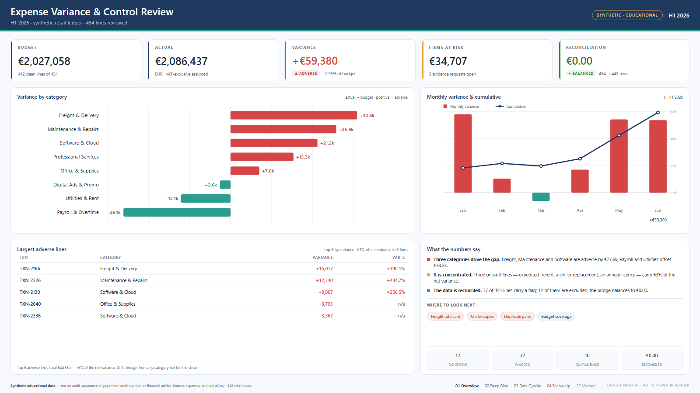

# Power BI Layer — Build Guide, Measures, Theme and Mockup

> **Boundary.** Synthetic educational data only. Not an audit, assurance
> engagement, audit opinion or financial advice. Every report page must carry the
> synthetic-data disclaimer.

**Status: design and build assets complete; the `.pbix` is authored locally in
Power BI Desktop.** No `.pbix` is committed, because a report cannot be created
or visually verified from a headless environment. Nothing in this folder claims
otherwise.

---

## Start here

| File | What it is |
|---|---|
| [`POWER_BI_BUILD_GUIDE.md`](POWER_BI_BUILD_GUIDE.md) | The full step-by-step build: model, DAX, page-by-page visuals, verification, screenshots |
| [`DAX_MEASURES.md`](DAX_MEASURES.md) | Copy-paste measure library, naming contract and validation measures |
| [`theme_expense_review.json`](theme_expense_review.json) | Power BI theme: navy/teal/coral palette and text classes |
| [`data/`](data/) | Three support tables: control tests, risk matrix, selected follow-ups |
| [`screenshots/`](screenshots/) | Design mockup (clearly labelled) and the real-capture checklist |

---

## Report at a glance

| # | Page | Question it answers |
|---|---|---|
| 1 | Executive Overview | How big is the gap, where is it, and is the data sound? |
| 2 | Variance Deep Dive | Which category × month cells and which lines drive it? |
| 3 | Data Quality & Controls | What was wrong with the data, and which controls can we test? |
| 4 | Follow-Up & Actions | What are we asking for, and what would change the conclusion? |
| 5 | Method & Verification *(appendix)* | How was every number produced, and does it reconcile? |

The design rationale, wireframes and visual specifications are in
[`POWER_BI_BUILD_GUIDE.md` §2 and §6](POWER_BI_BUILD_GUIDE.md#2-recommended-report-architecture).

---

## Design mockup

*Design mockup of page 1, rendered from `screenshots/dashboard_mockup.html`. It
is **not** a Power BI render; it locks the layout, palette and copy before the
`.pbix` is built.*

---

## Data sources

Use the same audited extract the Python and SQL layers use:

| Source | Path | Notes |
|---|---|---|
| Flat file | `data/processed/expenses_audited_all.csv` | 454 rows; 442 included |
| PostgreSQL | `fact_expenses` (see `sql/01_create_tables.sql`) | Same rows, typed columns |
| Support tables | `power_bi/data/*.csv` | Control tests, risk matrix, follow-ups |

Filter `Included = TRUE` for every financial page. Keep the 12 excluded rows
visible only on the data-quality page.

---

## Non-negotiables

- **Positive variance = adverse.** Never flip the sign between pages.
- **Variance % is blank** when budget < €100. Show `n/a`, not `0%`.
- **Reconciliation Gap must be €0.00** before any figure is published.
- **37 unique flagged rows**, not 35: 35 planted defects, 39 check hits, two rows
  with two flags each.
- **Follow-ups are evidence requests**, not findings.

---

## Build checklist

- [ ] Follow `POWER_BI_BUILD_GUIDE.md` §5 to load and model the data.
- [ ] Add the measures from `DAX_MEASURES.md`; confirm every validation measure is 0.
- [ ] Import `theme_expense_review.json`.
- [ ] Build pages 1–5; add the disclaimer to each.
- [ ] Verify against `POWER_BI_BUILD_GUIDE.md` §7.
- [ ] Capture the screenshots per `screenshots/README.md`.
- [ ] Save as `power_bi/expense_variance_control_review.pbix`, commit and push.
- [ ] Replace the mockup in this README with a real capture, or keep it clearly
      labelled as a design comp.

Until the checklist is complete, the main README keeps the dashboard at
**Design + build assets complete; report to be authored locally**.
